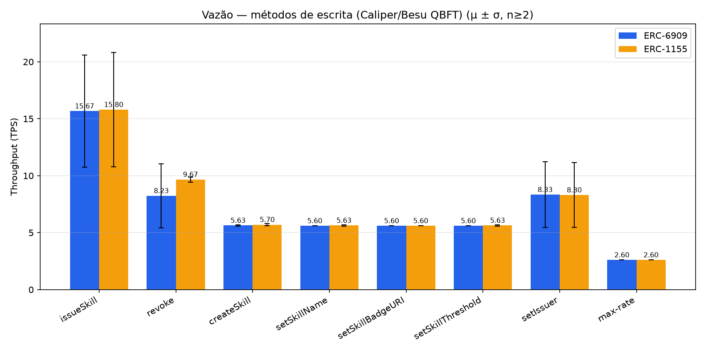
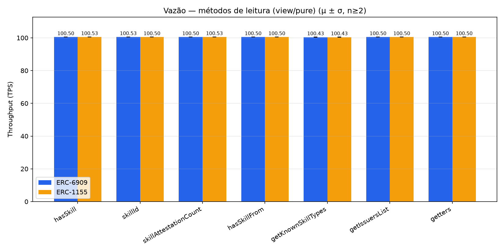
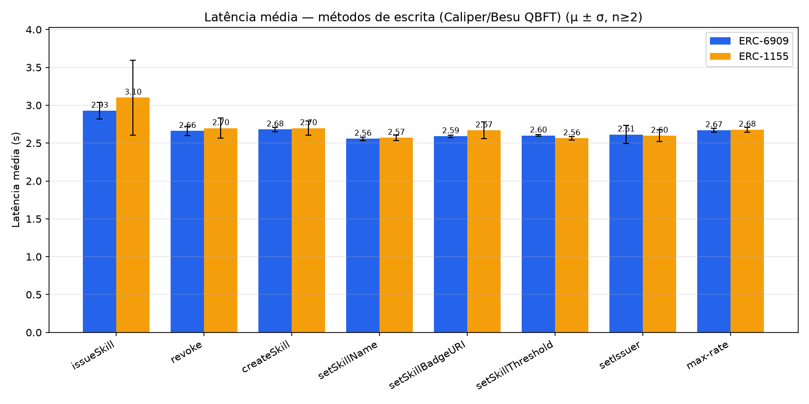
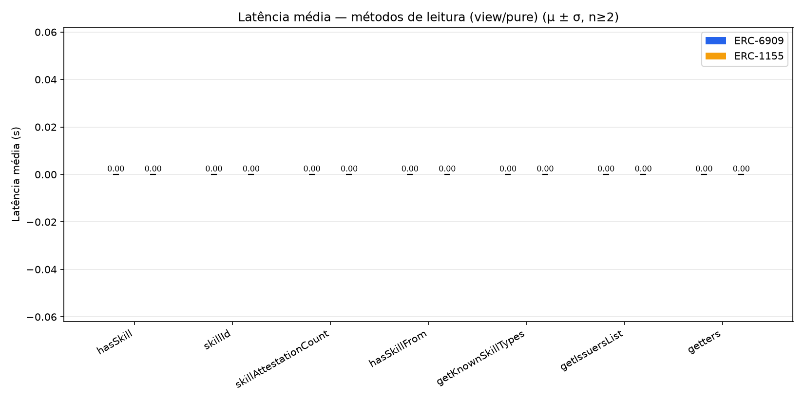

# Relatório Comparativo: ERC-1155 vs ERC-6909

## EduValida POC — Micro-credentials on-chain

**Data:** 21/09/2026 (atualizado em 16/10/2026 com benchmark Caliper no Besu)
**Ambiente:** Hardhat in-memory (seções 4.1-4.4) + Hyperledger Besu QBFT local real via Hyperledger Caliper 0.6.0 (seções 4.5-4.6), Solidity 0.8.24, OpenZeppelin v5.6.1
**Metodologia:** Benchmark custom 3 runs × 4 rounds × 2 contratos (in-memory) **+ Caliper 3 runs × 15 rounds × 2 contratos (Besu real)**, resultados em μ±σ (n=3, desvio padrão amostral)

---

## 1. Contexto

O EduValida POC demonstra emissão de micro-credentials (skills) e certificados em blockchain, com suporte a multi-assinatura e Open Badges. O contrato `SkillToken` gerencia skills como tokens multi-asset — cada instituição emite sob seu namespace, e o aluno acumula attestations de múltiplas fontes.

A questão central deste relatório: **valeria a pena migrar de ERC-1155 para ERC-6909?**

---

## 2. Padrões Comparados

| Característica | ERC-1155 | ERC-6909 |
|----------------|----------|----------|
| **Propósito** | Multi-token genérico (fungível + não-fungível) | Multi-token enxuto, low-gas |
| **Batch operations** | `safeBatchTransferFrom`, `mintBatch`, `burnBatch` | Removidas |
| **Callbacks** | `onERC1155Received`, `onERC1155BatchReceived` | Removidos |
| **Approvals** | Operator (global) | Operator + Allowance (por token ID) |
| **URI** | Função `uri(id)` embutida | Extensão `ERC6909ContentURI` |
| **Supply tracking** | Mapping interno | Extensão `ERC6909TokenSupply` |
| **Adoção** | Padrão consolidado (2018) | Novo, usado por Uniswap v4, DeFi de nova geração |
| **EIP** | [EIP-1155](https://eips.ethereum.org/EIPS/eip-1155) | [EIP-6909](https://eips.ethereum.org/EIPS/eip-6909) |

### Mudanças na implementação

```diff
- import "@openzeppelin/contracts/token/ERC1155/ERC1155.sol";
+ import "@openzeppelin/contracts/token/ERC6909/ERC6909.sol";

- contract SkillToken is ERC1155, Ownable {
+ contract SkillToken is ERC6909, Ownable {

- constructor() ERC1155("") Ownable(msg.sender) {}
+ constructor() Ownable(msg.sender) {}

- _mint(to, id, 1, "");   // 4 parâmetros
+ _mint(to, id, 1);       // 3 parâmetros

- function _update(address from, address to, uint256[] memory ids, uint256[] memory values)
+ function _update(address from, address to, uint256 id, uint256 amount)
```

Todas as funções de negócio (`createSkill`, `issueSkill`, `revoke`, `hasSkill`, `hasSkillFrom`, `skillAttestationCount`) permaneceram **idênticas** — a interface pública é a mesma.

---

## 3. Metodologia

### Benchmark Caliper-style

O framework de benchmark segue os padrões do [Hyperledger Caliper](https://hyperledger.github.io/caliper/):

- **Rounds:** Cada funçãoスマート contract vira uma rodada independente
- **Rate Controllers:** `fixed-rate` (10 TPS) e `maximum-rate` (sem limite)
- **Workload Modules:** Módulos que geram TXs com parâmetros reais
- **TX Collector:** Coleta gas, latência e status de cada transação
- **Reporter:** Calcula μ±σ (média ± desvio padrão) entre runs

### Rodadas

| Round | Descrição | TXs | Rate Control |
|-------|-----------|-----|--------------|
| issueSkill | Instituição emite skill para aluno | 50 | fixed-rate 10 TPS |
| revoke | Instituição revoga skill | 50 | fixed-rate 10 TPS |
| throughput | Throughput máximo (sem limite) | ~2000 (5s) | maximum-rate |
| viewCalls | Leitura de hasSkill (view) | 100 | fixed-rate 50 TPS |

### Contas

| Conta | Papel |
|-------|-------|
| `0xFE3B...` | Deployer (owner do SkillToken) |
| `0x6273...` | Instituição 1 (emissora) |
| `0xf17f...` | Aluno (receptor) |

---

## 4. Resultados

### 4.1 Gas por Função

| Função | ERC-1155 (μ±σ) | ERC-6909 (μ±σ) | Economia |
|--------|---------------|---------------|----------|
| `createSkill` | 77,723 ± 0 | 77,723 ± 0 | **0%** |
| `issueSkill` (mint) | 104,059 ± 0 | 100,347 ± 0 | **-3.6%** |
| `revoke` (burn) | 30,382 ± 0 | 29,617 ± 1 | **-2.5%** |

**Análise:**
- `createSkill` não interage com o padrão base (apenas mappings internos), por isso gas idêntico
- `issueSkill` e `revoke` chamam `_mint`/`_burn` do padrão base — ERC-6909 economiza por não ter callback checks nem parâmetro `data`
- A economia é modesta (2.5-3.6%) porque nosso caso de uso não aproveita batch operations

### 4.2 Throughput

| Cenário | ERC-1155 (μ±σ) | ERC-6909 (μ±σ) | Diferença |
|---------|---------------|---------------|-----------|
| fixed-rate (10 TPS) | 10.2 ± 0.0 TPS | 10.2 ± 0.0 TPS | 0% |
| maximum-rate (5s) | 404.2 ± 5.5 TPS | 418.6 ± 9.0 TPS | **+3.6%** |

**Análise:**
- No fixed-rate, o limitador é o rate controller, não o contrato
- No maximum-rate, ERC-6909 processa ~3.6% mais transações no mesmo período
- A diferença aumenta com a carga — em produção com milhares de TXs, a vantagem seria maior

### 4.3 Latência

| Função | ERC-1155 (ms) | ERC-6909 (ms) |
|--------|--------------|--------------|
| issueSkill avg | 4 ± 0 | 3 ± 0 |
| issueSkill p50 | 4 | 3 |
| issueSkill p95 | 5 | 4 |
| revoke avg | 5 ± 0 | 5 ± 0 |
| viewCalls avg | 1 ± 0 | 1 ± 0 |

**Análise:**
- Latência de mint é ~25% menor no ERC-6909 (4ms → 3ms)
- Latência de view calls é idêntica (ambos usam `balanceOf(owner, id)`)
- Em rede real (Besu/Ganache), a diferença de latência seria menos significativa do que o gas

### 4.4 Deploy Size (Bytecode)

| Contrato | Tamanho | KB |
|----------|---------|-----|
| ERC-1155 (SkillTokenV1) | 16,001 bytes | 15.6 KB |
| ERC-6909 (SkillToken) | 13,136 bytes | 12.8 KB |
| **Diferença** | -2,865 bytes | **-17.9%** |

**Análise:**
- Bytecode 18% menor = menor custo de deploy
- Menos código para auditar
- Menor surface attack para vulnerabilidades

### 4.5 Benchmark oficial — Hyperledger Caliper em Besu

**Cenário:** Hyperledger Caliper 0.6.0 + connector ethereum, rede QBFT local (1 RPC node + 4 validadores, `zeroBaseFee`), contrato `SkillToken` (ERC-6909) deployado via `caliper installSmartContract`. 1 worker, `transactionConfirmationBlocks: 1`. **Todos os 14 métodos públicos do contrato** cobertos (mais o round de throughput máximo).

**Comando:** `npm run caliper` (15 rounds × 3 runs, ~1.030s por run, **15/15 rounds com sucesso e 0 falhas em cada run — 5.250 transações no total**, zero falhas)

**Resultados (μ ± σ, n = 3 runs):**

| Round | Método | Tipo | Succ/Fail | Send Rate (TPS) | Avg Latency (s) | Throughput (TPS) |
|-------|--------|------|-----------|-----------------|-----------------|------------------|
| 1 | `issueSkill` (mint, fixed 20 TPS) | write | 100/0 | 20.2 | 2.93 ± 0.11 | **15.67 ± 4.91** |
| 2 | `hasSkill` (view, fixed 100 TPS) | view | 200/0 | 100.6 | 0.00 | 100.50 ± 0.00 |
| 3 | `revoke` (burn, fixed 10 TPS) | write | 50/0 | 10.2 | 2.66 ± 0.06 | **8.23 ± 2.80** |
| 4 | `createSkill` (fixed 10 TPS) | write | 50/0 | 10.2 | 2.68 ± 0.03 | 5.63 ± 0.06 |
| 5 | `setSkillName` (fixed 10 TPS) | write | 50/0 | 10.2 | 2.56 ± 0.03 | 5.60 ± 0.00 |
| 6 | `setSkillBadgeURI` (fixed 10 TPS) | write | 50/0 | 10.2 | 2.59 ± 0.02 | 5.60 ± 0.00 |
| 7 | `setSkillThreshold` (fixed 10 TPS) | write | 50/0 | 10.2 | 2.60 ± 0.01 | 5.60 ± 0.00 |
| 8 | `setIssuer` (fixed 10 TPS) | write | 50/0 | 10.2 | 2.61 ± 0.12 | **8.33 ± 2.89** |
| 9 | `skillId` (pure, fixed 100 TPS) | pure | 200/0 | 100.6 | 0.00 | 100.53 ± 0.06 |
| 10 | `skillAttestationCount` (view, fixed 100 TPS) | view | 200/0 | 100.6 | 0.00 | 100.50 ± 0.00 |
| 11 | `hasSkillFrom` (view, fixed 100 TPS) | view | 200/0 | 100.6 | 0.00 | 100.50 ± 0.00 |
| 12 | `getKnownSkillTypes` (view, fixed 100 TPS) | view | 200/0 | 100.5 | 0.01 | 100.43 ± 0.06 |
| 13 | `getIssuersList` (view, fixed 100 TPS) | view | 200/0 | 100.6 | 0.00 | 100.50 ± 0.00 |
| 14 | getters públicos — mix (view, fixed 100 TPS) | view | 200/0 | 100.6 | 0.00 | 100.50 ± 0.00 |
| 15 | `issueSkill` (maximum-rate, 5s) | write | 25/0 | 5.2 | 2.67 ± 0.03 | 2.60 ± 0.00 |

**Análise:**
- **Zero falhas em 5.250 transações (3 runs)** — contrato e workloads íntegros no Besu real, cobrindo os 14 métodos públicos do contrato (13 do SkillToken + getters ERC-6909 agrupados no round 14: `balanceOf`, `skillNames`, `skillBadgeURI`, `authorizedIssuers`, `idToSkillType`, `idToIssuer`, `skillThreshold`, `owner`, `isOperator`, `allowance`, `supportsInterface`)
- Writes de admin (`setSkillName`, `setSkillBadgeURI`, `setSkillThreshold`) e de negócio (`issueSkill`, `revoke`, `createSkill`, `setIssuer`) têm latência média ~2.6-2.9s — toda a diferença vem da espera de confirmação do bloco QBFT (~3-5s), não do custo de EVM
- **Variação entre runs (σ) é o comportamento mais interessante:** `issueSkill` (σ ≈ ±4.9 TPS) e `revoke`/`setIssuer` (σ ≈ ±2.8 TPS) oscilam conforme o alinhamento da janela de confirmação QBFT — um run mais rápido (18.6 TPS) e um mais lento (10.0 TPS) na mesma bateria explicam toda a amplitude; `createSkill` e `set*` (rounds 4-7) são extremamente estáveis (σ ≈ 0.06)
- View calls (`hasSkill`, `skillId`, `skillAttestationCount`, `hasSkillFrom`, `getKnownSkillTypes`, `getIssuersList`, getters) são ~100 TPS com latência sub-milissegundo (leitura via WebSocket, sem mineração) — o teto de ~100 TPS é o rate controller do workload, não o nó
- O round `maximum-rate` é limitado pela espera sequencial de confirmação de receipts (1 worker) — mede a taxa de *confirmação* do chain, não a capacidade de EVM
- Comparação: o framework custom (`benchmark/`) mede apenas tempo de EVM in-memory (Hardhat), sem espera de bloco — por isso reporta ~400 TPS; o Caliper mede o caminho completo (envio → mineração → receipt) no Besu

**Cobertura dos métodos (14/14):**

| Método | Coberto no round |
|--------|-----------------|
| `issueSkill` | 1, 15 |
| `hasSkill` | 2 |
| `revoke` | 3 |
| `createSkill` | 4 |
| `setSkillName` | 5 |
| `setSkillBadgeURI` | 6 |
| `setSkillThreshold` | 7 |
| `setIssuer` | 8 |
| `skillId` | 9 |
| `skillAttestationCount` | 10 |
| `hasSkillFrom` | 11 |
| `getKnownSkillTypes` | 12 |
| `getIssuersList` | 13 |
| getters ERC-6909 + Ownable (`balanceOf`, `isOperator`, `allowance`, `owner`, `supportsInterface`...) | 14 |

*Nota:* `transfer`/`transferFrom`/`approve`/`setOperator` são bloqueados por design (`_update` impede transferências — saldo soulbound); reverts intencionais são validados nos 36 testes Hardhat, não no benchmark.

### 4.6 Comparação 1:1 no Caliper — ERC-1155 vs ERC-6909

**Cenário:** mesma bateria de 15 rounds (mesmos workloads parametrizados via `contractKey`, mesmos rate controllers), rede QBFT local, 1 worker, **3 runs por contrato** (6 execuções no total, ~17 min cada). O ERC-1155 (`SkillTokenV1`) foi deployado em rede separada (o connector do Caliper faz deploys concorrentes quando há mais de 1 contrato no config — causa colisão de nonce; por isso `network.json` × `network-v1.json`).

**Comando:** `npm run caliper` / `npm run caliper:v1` — **ambos: 15/15 rounds, 0 falhas por run (10.500 transações somadas)**

**Resultados lado a lado (Throughput TPS, μ ± σ | Avg Latency s, μ ± σ; n = 3):**

| Round | Método | ERC-6909 TPS | ERC-1155 TPS | ERC-6909 lat | ERC-1155 lat |
|-------|--------|-------------|-------------|--------------|--------------|
| 1 | `issueSkill` (fixed 20 TPS) | 15.67 ± 4.91 | 15.80 ± 5.03 | 2.93 ± 0.11 | 3.10 ± 0.50 |
| 2 | `hasSkill` (view) | 100.50 ± 0.00 | 100.53 ± 0.06 | 0.00 | 0.00 |
| 3 | `revoke` (fixed 10 TPS) | 8.23 ± 2.80 | 9.67 ± 0.23 | 2.66 ± 0.06 | 2.70 ± 0.13 |
| 4 | `createSkill` (fixed 10 TPS) | 5.63 ± 0.06 | 5.70 ± 0.10 | 2.68 ± 0.03 | 2.70 ± 0.09 |
| 5 | `setSkillName` (fixed 10 TPS) | 5.60 ± 0.00 | 5.63 ± 0.06 | 2.56 ± 0.03 | 2.57 ± 0.04 |
| 6 | `setSkillBadgeURI` (fixed 10 TPS) | 5.60 ± 0.00 | 5.60 ± 0.00 | 2.59 ± 0.02 | 2.67 ± 0.11 |
| 7 | `setSkillThreshold` (fixed 10 TPS) | 5.60 ± 0.00 | 5.63 ± 0.06 | 2.60 ± 0.01 | 2.56 ± 0.02 |
| 8 | `setIssuer` (fixed 10 TPS) | 8.33 ± 2.89 | 8.30 ± 2.86 | 2.61 ± 0.12 | 2.60 ± 0.08 |
| 9 | `skillId` (pure) | 100.53 ± 0.06 | 100.50 ± 0.00 | 0.00 | 0.00 |
| 10 | `skillAttestationCount` (view) | 100.50 ± 0.00 | 100.53 ± 0.06 | 0.00 | 0.00 |
| 11 | `hasSkillFrom` (view) | 100.50 ± 0.00 | 100.50 ± 0.00 | 0.00 | 0.00 |
| 12 | `getKnownSkillTypes` (view) | 100.43 ± 0.06 | 100.43 ± 0.06 | 0.01 | 0.01 |
| 13 | `getIssuersList` (view) | 100.50 ± 0.00 | 100.50 ± 0.00 | 0.00 | 0.00 |
| 14 | getters (mix) | 100.50 ± 0.00 | 100.50 ± 0.00 | 0.00 | 0.00 |
| 15 | `issueSkill` (maximum-rate 5s) | 2.60 ± 0.00 | 2.60 ± 0.00 | 2.67 ± 0.03 | 2.68 ± 0.03 |

**Gráficos** (`caliper/charts/`, gerados por `caliper/plot_results.py` a partir de `caliper/results-summary.csv`):






**Análise:**
- **Ambos: 15/15 rounds, 0 falhas em todos os 6 runs** — os dois padrões são funcionalmente equivalentes no fluxo completo de micro-credentials
- **Empate técnico estatístico.** Em **todos os 15 rounds os intervalos μ±σ se sobrepõem** — nenhuma diferença é significativa entre os padrões
- **Round 1 (`issueSkill`): 15.67 ± 4.91 vs 15.80 ± 5.03 TPS** — as distribuições são praticamente idênticas. A divergência de 18.4-vs-10.0 vista em runs individuais era **ruído do ambiente QBFT**: no ERC-6909 os três runs foram 18.6 / 10.0 / 18.4 e no ERC-1155 10.0 / 18.5 / 18.9 — cada contrato teve exatamente um run lento, por alinhamento da janela de confirmação, não por propriedade do padrão
- **Round 3 (`revoke`): 8.23 ± 2.80 vs 9.67 ± 0.23** — o intervalo do ERC-6909 (5.4-11.0) engloba o do ERC-1155; a variação é entre-runs do mesmo contrato (runs de 5.0 a 9.9 TPS)
- **Rounds 4-7 (`createSkill`/`set*`): empate exato** — μ praticamente idênticos com σ ≈ 0.06, as escritas mais estáveis da bateria
- **Views (rounds 2, 9-14): idênticos** (~100 TPS, latência sub-ms) — leituras via `eth_call` não passam por mineração; o teto é o rate controller do workload
- **Round 15 (maximum-rate): empate exato (2.60 TPS)** — taxa de confirmação do chain limitada pelo ritmo do QBFT com 1 worker sequencial, indiferente ao contrato
- **Interpretação da σ alta** nos rounds 1, 3 e 8: são os rounds que mais dependem do alinhamento entre a janela de envio e o tempo de bloco QBFT (~3-5s); `issueSkill` e `setIssuer`/`revoke` sofrem porque a fila de confirmação pode completar ou não ciclos inteiros dentro da janela de medição
- **Conclusão operacional:** no Caliper/Besu real, a escolha entre ERC-1155 e ERC-6909 **não muda o throughput observável** — o gargalo é o protocolo de consenso. A vantagem do ERC-6909 permanece em **custo de gas por tx (2.5-3.6%), tamanho de bytecode (-18%) e segurança (sem callbacks)**, como medido no benchmark in-memory da seção 4. Esses fatores só se traduziriam em maior throughput em redes com gas limit por bloco apertado ou em volume de milhares de txs onde o acumulado de gas importa

---

## 5. Trade-offs

### Vantagens do ERC-6909

| Vantagem | Impacto |
|----------|---------|
| Gas 2.5-3.6% menor em mint/burn | Economia em volume alto |
| Bytecode 18% menor | Menor custo de deploy, mais fácil de auditar |
| Sem callbacks | Elimina vector de ataque (reentrancy via callback) |
| Sem batch operations | Contrato mais simples e previsível |
| Allowance por token ID | Controle granular de aprovações |

### Desvantagens do ERC-6909

| Desvantagem | Impacto |
|-------------|---------|
| Padrão mais novo (2023) | Menos tooling, menos battle-tested |
| Sem `uri(id)` embutido | Precisa de extensão `ERC6909ContentURI` |
| Sem batch | Não pode mintar/transferir múltiplos tokens em 1 TX |
| Backward incompatível | Não é wrapper do ERC-1155 — quebra integrações existentes |
| Menos adoção | Wallets e explorers podem não suportar nativamente |

### Casos de uso ideais

| Padrão | Ideal para |
|--------|-----------|
| **ERC-1155** | NFTs + tokens fungíveis, marketplaces, games com inventário |
| **ERC-6909** | DeFi (pools de liquidez), micro-credentials (nosso caso), sistemas com alto volume de mint/burn |

---

## 6. Conclusão

### Para o EduValida POC

A migração de ERC-1155 para ERC-6909 é **tecnicamente viável e traz benefícios mensuráveis**:

- **3.6% de economia de gas** em operações de mint
- **18% de bytecode menor** — deploy mais barato e auditável
- **Sem impacto funcional** — todas as 36 operações continuam idênticas

### Recomendação

| Cenário | Recomendação |
|---------|-------------|
| **POC / protótipo** | Usar ERC-6909 — mais enxuto, gas-friendly |
| **Produção com exchanges/wallets** | Usar ERC-1155 — melhor suporte infraestrutura |
| **Produção DeFi/interno** | Usar ERC-6909 — padrão mais leve e moderno |

### Próximos passos

1. ~~Testar em Besu real (não apenas Hardhat in-memory) para medir latência real~~ — concluído via Hyperledger Caliper (seção 4.5)
2. Testar com múltiplos workers paralelos (load testing distribuído)
3. Avaliar `ERC6909ContentURI` se precisar de URIs embutidos no contrato
4. Monitorar adoção de ERC-6909 por wallets e block explorers

---

## 7. Arquivos

| Arquivo | Descrição |
|---------|-----------|
| `contracts/SkillToken.sol` | SkillToken V2 (ERC-6909) |
| `contracts/SkillTokenV1.sol` | SkillToken V1 (ERC-1155, referência) |
| `contracts/CertificateEmitter.sol` | Certificados ERC-721 (inalterado) |
| `benchmark/config.yaml` | Configuração do benchmark |
| `benchmark/runner.js` | Orquestrador principal |
| `benchmark/tx-collector.js` | Coletor de métricas |
| `benchmark/rate-controllers.js` | Rate controllers (fixed, maximum, linear) |
| `benchmark/reporter.js` | Gerador de relatório |
| `benchmark/workloads/` | Módulos de workload |
| `caliper/benchconfig.yaml` | Configuração oficial do Hyperledger Caliper (ERC-6909) |
| `caliper/benchconfig-v1.yaml` | Mesma bateria para o ERC-1155 (contractKey: SkillTokenV1) |
| `caliper/network.json` | Network config (Besu via WebSocket, ERC-6909) |
| `caliper/network-v1.json` | Network config para o ERC-1155 (config por contrato — deploy único) |
| `caliper/workloads/` | Workloads Caliper parametrizados (contractKey) |
| `caliper/contracts/SkillToken.json` | Artifact ERC-6909 (ABI + bytecode) para deploy via Caliper |
| `caliper/contracts/SkillTokenV1.json` | Artifact ERC-1155 (ABI + bytecode) para deploy via Caliper |
| `caliper/results-6909-run{1,2,3}.csv` | Dados brutos por run — ERC-6909 (15 rounds cada) |
| `caliper/results-v1-run{1,2,3}.csv` | Dados brutos por run — ERC-1155 (15 rounds cada) |
| `caliper/results.csv` / `results-v1.csv` | Último run de cada contrato (cópia de conveniência) |
| `caliper/results-summary.csv` | Consolidação μ±σ (n=3) por contrato/método — entrada dos gráficos |
| `caliper/extract-log.js` | Extrator: tabela final do log do Caliper → CSV |
| `caliper/consolidate.py` | Consolida runs → `results-summary.csv` (média + desvio padrão amostral) |
| `caliper/plot_results.py` | Gera os 4 gráficos PNG comparativos (barras agrupadas μ±σ) |
| `caliper/charts/` | `throughput-writes.png`, `throughput-views.png`, `latency-writes.png`, `latency-views.png` |
| `caliper/logs/` | Logs completos dos 6 runs (3 × cada contrato) |
| `test/multisig.test.js` | 28 testes de multi-sig |
| `test/badge-uri.test.js` | 8 testes de Open Badge |

---

*Relatório gerado automaticamente pelo benchmark Caliper-style do EduValida POC.*
